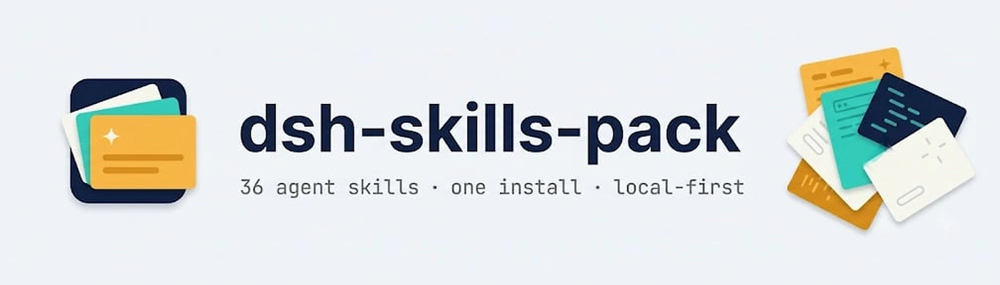

<picture>
  <source media="(prefers-color-scheme: dark)" srcset="assets/banner-dark.png">
  
</picture>

<br>

# dsh-skills-pack

English | [中文](README.zh-CN.md)

      

A [DeepSeek Harness](https://github.com/deepseek-ai/deepseek-harness) plugin that installs **36 agent skills in one step**. After installing, every skill below appears in the session catalog and loads on demand — research writing, LaTeX builds, experiment discipline, design review, office documents, animation, and Windows shell conventions.

It is a **skill provider**, not a copier:

- The skills are served straight from the installed package through dsh's skill registry (`ctx.skills.registerProvider`). Nothing is written into `~/.dsh/skills` or `~/.agents/skills`.
- **Your own skills always win.** A skill you keep in any local root (project `.dsh/skills`, `.agents/skills`, `~/.dsh/skills`, `~/.agents/skills`) shadows the bundled skill of the same name.
- **Clean uninstall.** Disabling or removing the plugin removes all 36 bundled skills — no orphan files, no leftovers.
- No postinstall, no build scripts, no native dependencies. The only runtime dependency is the pure-JS `yaml` parser, so the pnpm `ERR_PNPM_IGNORED_BUILDS` trap does not apply.

## What's inside

| Category | Skill | What it does |
|---|---|---|
| Research & writing | `academic-unslop` | Removes AI tells from paper prose; plain, precise academic English |
| | `deep-research` | Wide verified research sweep with parallel subagents |
| | `lit-review` | Reads real related papers, writes cited related work + verified `.bib` |
| | `paper-review` | One fresh-context referee review, findings labeled major/minor/nit |
| | `claim-check` | Every number and empirical claim matched against its source |
| | `cite-verify` | Every citation checked against Crossref / arXiv; never invents one |
| | `rebuttal` | Point-by-point reviewer responses + tracked-changes PDF |
| | `venue-format` | Checks a paper against its target venue's submission rules |
| | `figure-tables` | Reproducible, print-ready, color-blind-safe figures and tables |
| LaTeX & submission | `latex-build` | Compiles for real and fixes from the actual `.log` |
| | `latex-edit` | Safe scoped `.tex` edits; labels, refs and macros preserved |
| | `arxiv-prep` | Flattened, comment-stripped, self-contained arXiv source bundle |
| Experiments | `experiment` | Baseline-first ML/RL experiment discipline; every number traceable |
| | `env-doctor` | Python/venv/CUDA/Node/TeX environment check before debugging |
| Design & code review | `ds-design` | Frontend with a clear visual direction, not the generic AI look |
| | `ds-design-audit` | Screenshot-scored UI review, then fixes the worst problems |
| | `ds-blast-radius` | What a change could break outside its diff, proven with real code |
| | `ds-tdd` | Failing test first, then the smallest change that passes |
| | `ds-review-loop` | One fresh-context review subagent per round, max four |
| | `ds-principles` | Compact engineering principles with triggers |
| | `ds-lessons` | Turns repeated agent mistakes into structure that blocks them |
| | `ds-unslop` | Plain, specific English for replies, docs and comments |
| | `ds-unstick` | Breaks repeating failure loops by testing the hidden assumption |
| Documents & media | `docx` | Create, read and edit Word documents |
| | `pdf` | Read, extract, merge, split, watermark and create PDFs |
| | `pptx` | Create, read and edit PowerPoint decks |
| | `xlsx` | Create, read and edit spreadsheets |
| | `art-motion` | 36 art styles + 9 explainer-animation grammars (Huashu fork) |
| | `reverse-engineer-anything` | REA for native, Electron, firmware and browser targets |
| | `image-icon` | One image → a dsh plugin icon under the 256 KiB cap |
| Workflow & environment | `checkpoint` | Restore points before risky edits, git or plain folders |
| | `handoff` | End-of-session handoff notes for the next session |
| | `secrets-guard` | Keeps keys and credentials out of code, commits and artifacts |
| | `find-skills` | Discovers and installs further agent skills |
| | `win-shell` | Windows shell rules: Git Bash vs PowerShell, paths, git/gh |
| | `dsh-plugin-dev` | Conventions and pitfalls for building dsh plugins |

## Install

```sh
dsh plugin --profile web add dsh-skills-pack
dsh --profile web
```

Or straight from GitHub, before npm:

```sh
dsh plugin --profile web add github:adithyanraj03/dsh-skills-pack
```

### In the desktop app

1. Open **Plugins** (settings, left sidebar) and click **Add plugin**.
2. Paste the repository address (the package name `dsh-skills-pack` works too):

   ```
   https://github.com/adithyanraj03/dsh-skills-pack
   ```

3. Click **Install**, then restart dsh when prompted.

The plugin has no lifecycle scripts, so there is nothing to approve with `pnpm approve-builds`. Confirm it mounted — it must appear in both `dependencies` and `dsh.profile.bundles` in the profile's `package.json`, and `dsh --profile web --dump-config` must show exactly one `- id: skills-pack` row.

## How it works

The host half registers one provider on the skill registry. Discovery parses only each skill's YAML frontmatter; the body is re-read from the package on every load, and the skill's base directory is reported to the model so `references/`, `scripts/` and `assets/` resolve inside the installed package.

Precedence follows dsh's standard root ranks — the pack sits at the bundled rank, below every local root:

| Rank | Root | Wins over the pack? |
|---|---|---|
| 100 | `<project>/.dsh/skills` | yes |
| 200 | `<project>/.agents/skills` | yes |
| 300 | custom skill dirs | yes |
| 400 | `~/.dsh/skills` | yes |
| 500 | `~/.agents/skills` | yes |
| 600 | **dsh-skills-pack (this plugin)** | — |

To customize a bundled skill, copy its folder from the installed package into one of your local roots and edit it there; your copy takes over and survives plugin updates.

## Compatibility

| Host | Status |
|---|---|
| dsh 0.2.2-rc.1 (desktop + web profile) | Built against its skill registry (`registerProvider`, rank 600). Provider unit suite: 783 checks passing. Live mount not yet verified on a clean profile. |
| older hosts without `ctx.skills` | The row cannot activate (missing `skills` injection); nothing else is affected. |

## Update and uninstall

```sh
dsh plugin --profile web update dsh-skills-pack --latest
dsh plugin --profile web remove dsh-skills-pack
```

If the update stays pinned by `pnpm-lock.yaml`, use `pnpm add dsh-skills-pack@<version>` in the profile directory. Removing the plugin removes every bundled skill immediately; your local skills are untouched.

## Third-party skills

- `art-motion` is an English fork of [huashu-art-motion](https://github.com/alchaincyf/huashu-art-motion) by **花叔 (Huashu, alchaincyf)**, MIT. The Huashu cartoon likeness and character frames are licensed for that skill's demonstrations only; derived stroke-order data retains the Arphic Public License and bundled fonts their OFL licenses. The pack ships the skill without the README-only showcase GIFs (~40 MB trimmed); `hero.png` and the clip notes remain.
- The nine `ds-*` skills are MIT, Copyright (c) 2026 **AICodeKing**; each directory carries its own LICENSE.
- `dsh-plugin-dev` and `win-shell` were generalized for distribution (machine-specific paths replaced with placeholders).

## Development

```sh
npm install
npm test        # 783 checks: provider round-trip of all 36 skills + packaging invariants
```

Layout: `src/index.js` (provider), `skills/` (the 36 bundles), `cordis.patch.yml` (one insert row, id `skills-pack`), `locale/` (plugin-manager metadata), `scripts/test-provider.mjs`.

## License

MIT — see [LICENSE](LICENSE), including the bundled third-party notices.
