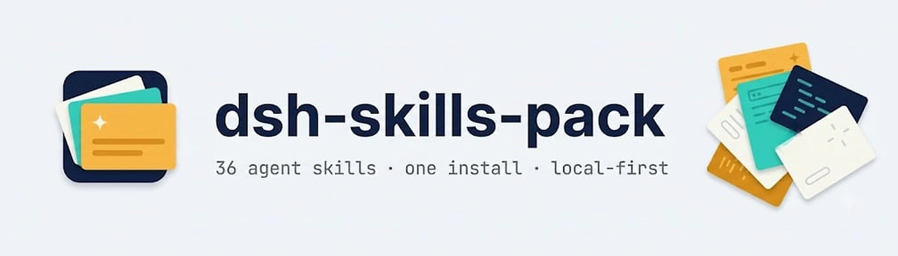

<picture>
  <source media="(prefers-color-scheme: dark)" srcset="assets/banner-dark.png">
  
</picture>

<br>

# dsh-skills-pack

[English](README.md) | 中文

      

一个 [DeepSeek Harness](https://github.com/deepseek-ai/deepseek-harness) 插件，**一次安装 36 个代理技能**。安装后，下列所有技能都会出现在会话目录中并按需加载：科研写作、LaTeX 编译、实验规范、设计评审、Office 文档、动画，以及 Windows shell 约定。

它是一个**技能提供器（skill provider）**，而不是复制器：

- 技能通过 dsh 技能注册表（`ctx.skills.registerProvider`）直接从已安装的包中提供，不会向 `~/.dsh/skills` 或 `~/.agents/skills` 写入任何文件。
- **你自己的技能永远优先。** 放在任何本地根目录（项目 `.dsh/skills`、`.agents/skills`、`~/.dsh/skills`、`~/.agents/skills`）中的同名技能会覆盖包内技能。
- **干净卸载。** 禁用或删除插件即移除全部 36 个内置技能——没有孤儿文件，没有残留。
- 没有 postinstall、没有构建脚本、没有原生依赖。唯一运行时依赖是纯 JS 的 `yaml` 解析器，因此不会触发 pnpm 的 `ERR_PNPM_IGNORED_BUILDS` 陷阱。

## 内容一览

| 类别 | 技能 | 作用 |
|---|---|---|
| 科研写作 | `academic-unslop` | 去除论文 prose 中的 AI 痕迹，改为平实精确的学术英语 |
| | `deep-research` | 并行子代理的多角度、可验证文献调研 |
| | `lit-review` | 阅读真实相关论文，撰写带引用的相关工作并校验 `.bib` |
| | `paper-review` | 单一新上下文审稿人评审，问题分 major/minor/nit |
| | `claim-check` | 每个数字与实证论断都对照其来源核验 |
| | `cite-verify` | 每条引用对照 Crossref / arXiv 核验，绝不臆造 |
| | `rebuttal` | 逐条回复审稿意见 +  tracked-changes PDF |
| | `venue-format` | 按目标期刊/会议投稿规则检查论文 |
| | `figure-tables` | 可复现、适合印刷、色盲友好的图表 |
| LaTeX 与投稿 | `latex-build` | 真实编译并根据 `.log` 修复错误 |
| | `latex-edit` | 安全的局部 `.tex` 编辑，保留标签、引用与宏 |
| | `arxiv-prep` | 扁平化、去注释、可独立编译的 arXiv 源码包 |
| 实验 | `experiment` | 基线优先的 ML/RL 实验规范，每个数字可追溯 |
| | `env-doctor` | 调试前检查 Python/venv/CUDA/Node/TeX 环境 |
| 设计与代码评审 | `ds-design` | 有明确视觉方向的前端，而非千篇一律的 AI 外观 |
| | `ds-design-audit` | 基于截图评分的 UI 评审并修复最严重问题 |
| | `ds-blast-radius` | 用真实代码证明改动会波及 diff 之外的什么 |
| | `ds-tdd` | 先写失败的测试，再做最小修复 |
| | `ds-review-loop` | 每轮一个新鲜上下文评审子代理，最多四轮 |
| | `ds-principles` | 带触发条件的精简工程原则 |
| | `ds-lessons` | 把重复犯的错误变成能阻止它的结构 |
| | `ds-unslop` | 回复、文档与注释改为平实具体的英语 |
| | `ds-unstick` | 检验隐藏假设，跳出重复失败的循环 |
| 文档与媒体 | `docx` | 创建、读取、编辑 Word 文档 |
| | `pdf` | PDF 读取、提取、合并、拆分、水印与创建 |
| | `pptx` | 创建、读取、编辑 PowerPoint 演示文稿 |
| | `xlsx` | 创建、读取、编辑电子表格 |
| | `art-motion` | 36 种艺术风格 + 9 种讲解动画语法（Huashu 分支） |
| | `reverse-engineer-anything` | 原生、Electron、固件与浏览器目标的逆向工程 |
| | `image-icon` | 一张图 → 小于 256 KiB 的 dsh 插件图标 |
| 工作流与环境 | `checkpoint` | 风险编辑前建立还原点（git 或普通目录） |
| | `handoff` | 会话结束时的交接笔记 |
| | `secrets-guard` | 让密钥与凭据远离代码、提交与产物 |
| | `find-skills` | 发现并安装更多代理技能 |
| | `win-shell` | Windows shell 规则：Git Bash 与 PowerShell、路径、git/gh |
| | `dsh-plugin-dev` | 构建 dsh 插件的约定与陷阱 |

## 安装

```sh
dsh plugin --profile web add dsh-skills-pack
dsh --profile web
```

或直接从 GitHub 安装：

```sh
dsh plugin --profile web add github:adithyanraj03/dsh-skills-pack
```

### 桌面应用

1. 打开 **Plugins**（设置，左侧栏），点击 **Add plugin**。
2. 粘贴仓库地址（包名 `dsh-skills-pack` 也可以）：

   ```
   https://github.com/adithyanraj03/dsh-skills-pack
   ```

3. 点击 **Install**，按提示重启 dsh。

插件没有生命周期脚本，无需用 `pnpm approve-builds` 批准任何内容。确认挂载成功：profile 的 `package.json` 中 `dependencies` 与 `dsh.profile.bundles` 都应出现它，且 `dsh --profile web --dump-config` 中恰好有一行 `- id: skills-pack`。

## 工作原理

host 半部分在技能注册表上注册一个提供器。发现阶段只解析每个技能的 YAML frontmatter；正文在每次加载时从包内重新读取，并向模型报告技能的基础目录，使 `references/`、`scripts/`、`assets/` 在已安装包内正确解析。

优先级遵循 dsh 标准根目录 rank——本包位于 bundled rank，低于所有本地根目录：

| Rank | 根目录 | 是否覆盖本包 |
|---|---|---|
| 100 | `<project>/.dsh/skills` | 是 |
| 200 | `<project>/.agents/skills` | 是 |
| 300 | 自定义技能目录 | 是 |
| 400 | `~/.dsh/skills` | 是 |
| 500 | `~/.agents/skills` | 是 |
| 600 | **dsh-skills-pack（本插件）** | — |

想定制某个内置技能：把它的文件夹从已安装包复制到任一本地根目录再编辑；你的副本会接管，并在插件更新后继续生效。

## 兼容性

| 宿主 | 状态 |
|---|---|
| dsh 0.2.2-rc.1（桌面 + web profile） | 按其技能注册表（`registerProvider`、rank 600）构建。提供器单元测试：783 项检查通过。尚未在干净 profile 上验证实际挂载。 |
| 没有 `ctx.skills` 的旧宿主 | 该行无法激活（缺少 `skills` 注入），不影响其他部分。 |

## 更新与卸载

```sh
dsh plugin --profile web update dsh-skills-pack --latest
dsh plugin --profile web remove dsh-skills-pack
```

若更新被 `pnpm-lock.yaml` 钉住，在 profile 目录执行 `pnpm add dsh-skills-pack@<version>`。删除插件会立即移除全部内置技能；你的本地技能不受影响。

## 第三方技能

- `art-motion` 是 **花叔（Huashu, alchaincyf）** 的 [huashu-art-motion](https://github.com/alchaincyf/huashu-art-motion) 的英文分支，MIT。Huashu 卡通形象与角色帧仅授权用于该技能的演示；派生笔顺数据保留 Arphic Public License，内置字体保留各自的 OFL 许可。本包去掉了仅 README 使用的展示 GIF（约 40 MB），保留 `hero.png` 与片段说明。
- 九个 `ds-*` 技能为 MIT，Copyright (c) 2026 **AICodeKing**；每个目录自带 LICENSE。
- `dsh-plugin-dev` 与 `win-shell` 为分发做了通用化处理（机器特定路径替换为占位符）。

## 开发

```sh
npm install
npm test        # 783 项检查：36 个技能的提供器往返 + 打包不变量
```

结构：`src/index.js`（提供器）、`skills/`（36 个技能包）、`cordis.patch.yml`（单行 insert，id `skills-pack`）、`locale/`（插件管理器元数据）、`scripts/test-provider.mjs`。

## 许可

MIT —— 见 [LICENSE](LICENSE)，含内置第三方声明。
